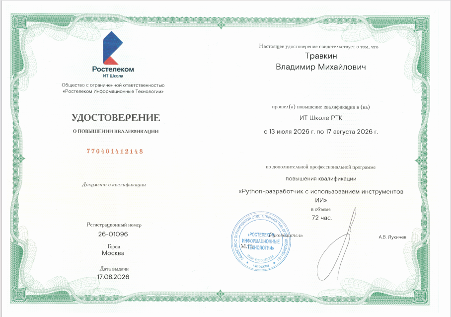

**English** | [Русский](README.ru.md)

# Vladimir Travkin | Python Backend Developer

**I help small businesses (pizzerias, salons, delivery services) launch simple Telegram bots and Mini Apps to take orders and manage bookings 24/7 — without the cost of expensive CRMs or custom mobile apps.**

*   🛒 **Direct Sales:** Cut marketplace fees by selling directly to your audience in Telegram.
*   📅 **Automation:** Free up your admins with 24/7 automated booking and zero double-bookings.
*   🤖 **AI-Assisted:** Leverage modern AI tools to write cleaner code faster and reduce development costs.
*   🎓 **Qualified:** Certified Python Developer (with AI tools integration).

📍 Kazan, Russia (UTC+3) • 💼 Available for project-based work (Turnkey)
*(Note: I handle the full dev cycle from specs to Docker deployment, but do not purchase hosting or domains).*

---

### 🛠️ Tech Stack & Tools

---

### 🚀 Featured Projects

#### 🛒 E-commerce Telegram Mini App & Bot
A full-fledged store inside Telegram. Direct sales channel without marketplace commissions.
*   **Stack:** Python, FastAPI, PostgreSQL, aiogram v3, Telegram WebApp SDK, Docker, Nginx.
*   **Key Features:** `initData` validation (HMAC-SHA256), YooKassa integration (test mode), Rate Limiting.
*   🔗 **[Open the Bot in Telegram](https://t.me/VM13TgShopBot)**

#### 🏥 MedBook API (REST API for Appointments)
Reliable backend for automating bookings (clinics, salons). Eliminates double-bookings and reduces staff workload.
*   **Stack:** Python, FastAPI, PostgreSQL, SQLAlchemy, Alembic, Redis, JWT, Docker.
*   🔗 **[Live Demo (Swagger UI)](https://medbook-api-sayq.onrender.com/docs)**

#### 🤖 Telegram Order Bot (Core System)
A robust bot for accepting and tracking orders, replacing manual manager chats.
*   **Stack:** Python, aiogram v3, PostgreSQL, SQLAlchemy 2.0, Redis, Docker.
*   🔗 **[Open the Bot in Telegram](https://t.me/VM13TgShopBot)**

---

### 🎓 Education & Certificates

*   **ООО «Ростелеком Информационные Технологии»** — Повышение квалификации: «Python-разработчик с использованием инструментов ИИ» (72 hours, 2026). Reg. number: 26-01096.
    

      
<i>👉 Click to view the certificate</i>

       
      
    

*   **Stepik** — [Git + GitHub. Полный курс](https://stepik.org/cert/3169213) (Result: 100%).
*   **Stepik** — [Профессия: Web-верстальщик [верстка + Git + GitHub]](https://stepik.org/cert/3169212) (Result: 99%).

---

### 📫 How to reach me

