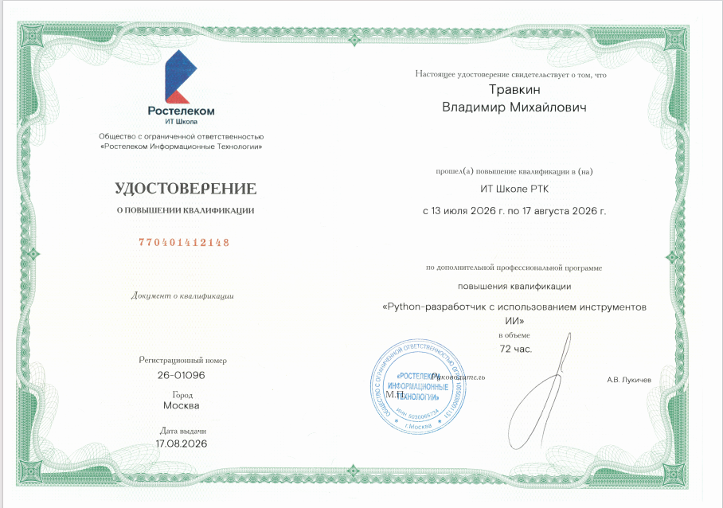

[English](README.md) | **Русский**

# Владимир Травкин | Python-разработчик

**Помогаю малому бизнесу (пиццерии, салоны, доставки) запускать простые Telegram-боты и Mini Apps для приема заказов и записи клиентов 24/7 — без затрат на дорогие CRM и разработку отдельных мобильных приложений.**

*   🛒 **Прямые продажи:** Уход от комиссий маркетплейсов и продажи напрямую аудитории в Telegram.
*   📅 **Автоматизация:** Разгрузка администраторов за счет записи 24/7 и исключения двойных бронирований.
*   🤖 **С поддержкой ИИ:** Использую современные ИИ-инструменты, чтобы писать чистый код быстрее и снижать стоимость разработки для вас.
*   🎓 **Квалификация:** Сертифицированный Python-разработчик (с использованием инструментов ИИ).

📍 Казань, Россия (МСК / UTC+3) • 💼 Доступен для проектной работы «под ключ»
*(Примечание: беру на себя полный цикл разработки от ТЗ до деплоя в Docker, но не занимаюсь покупкой хостинга и доменов).*

---

### 🛠️ Технологии

---

### 🚀 Избранные проекты

#### 🛒 E-commerce Telegram Mini App и бот
Полноценный магазин внутри Telegram. Прямой канал продаж без комиссий маркетплейсов.
*   **Стек:** Python, FastAPI, PostgreSQL, aiogram v3, Telegram WebApp SDK, Docker, Nginx.
*   **Фишки:** Валидация `initData` (HMAC-SHA256), интеграция ЮKassa (тестовый режим), Rate Limiting.
*   🔗 **[Открыть бота в Telegram](https://t.me/VM13TgShopBot)**

#### 🏥 MedBook API (REST API для записи)
Надежный бэкенд для автоматизации записи (клиники, салоны). Исключает двойные бронирования и снижает нагрузку на администраторов.
*   **Стек:** Python, FastAPI, PostgreSQL, SQLAlchemy, Alembic, Redis, JWT, Docker.
*   🔗 **[Живое демо (Swagger UI)](https://medbook-api-sayq.onrender.com/docs)**

#### 🤖 Telegram-бот для приема заказов (Ядро системы)
Надежный бот для приема и трекинга заказов, заменяющий ручную переписку менеджера.
*   **Стек:** Python, aiogram v3, PostgreSQL, SQLAlchemy 2.0, Redis, Docker.
*   🔗 **[Открыть бота в Telegram](https://t.me/VM13TgShopBot)**

---

### 🎓 Образование и сертификаты

*   **ООО «Ростелеком Информационные Технологии»** — Повышение квалификации: «Python-разработчик с использованием инструментов ИИ» (72 часа, 2026 г.). Рег. номер: 26-01096.
    

      
<i>👉 Нажмите, чтобы посмотреть бланк сертификата</i>

       
      
    

*   **Stepik** — [Git + GitHub. Полный курс](https://stepik.org/cert/3169213) (Результат: 100%).
*   **Stepik** — [Профессия: Web-верстальщик [верстка + Git + GitHub]](https://stepik.org/cert/3169212) (Результат: 99%).

---

### 📫 Связаться со мной

